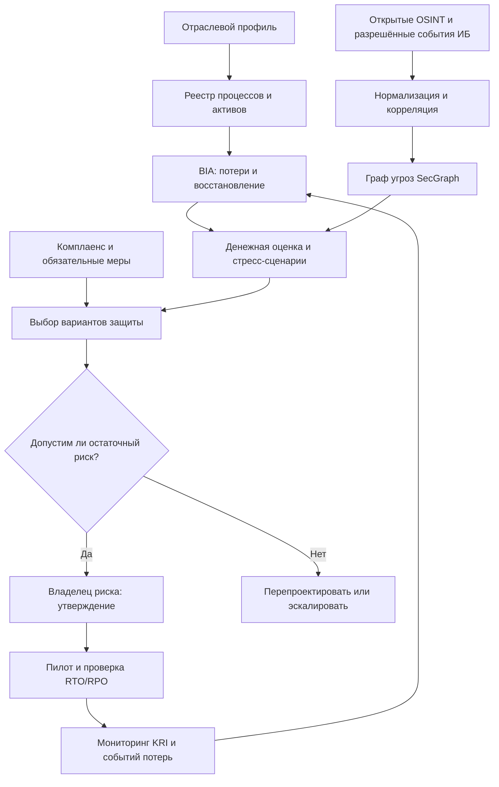

# Архитектура FATHER Risk Management System

## Компоненты
- API FastAPI, PostgreSQL для процессов/рисков/решений; аналитические расчёты отделены.
- SecGraph для графа объектов, сценариев, контролей и доказательств.
- Event Hub через адаптеры, дедупликация по event fingerprint, DLQ, идемпотентность.
- Decision Engine: детерминированные расчёты, версионированные допущения, интервал вероятности, варианты экономического выбора.
- Document Engine: risk passport, treatment plan, board memo, loss event report, evidence register.
- Workflows: роли, двухэтапные approvals для критичных решений, журнал изменений.
- LLM допускается для **черновиков и объяснений**, но не как доверенный вычислитель, судья юридического факта или автоматический акцептор критичного риска.
- Observability: технические SLO, token/cost budget, воспроизводимость расчётов, контроль качества моделей.

## Модель связей
Sector → BusinessProcess → Asset → Impact → ThreatScenario → RiskAssessment → TreatmentOption → Control → Evidence → Decision → Review.
Incident → LossEvent → фактические суммы и простой → обновление статистических оценок.

## Защита
RBAC/ABAC, MFA, секреты в vault, шифрование, разделение tenants, правомерное хранение доказательств, ПДн redaction, защита от prompt injection, immutable audit, срок хранения данных по политике.
