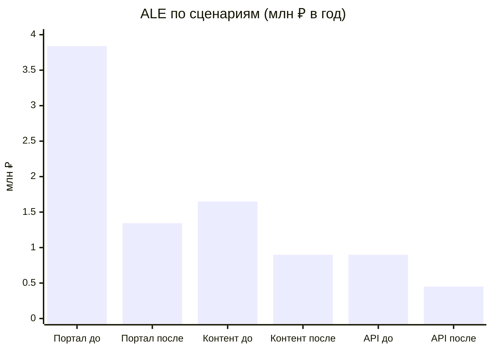
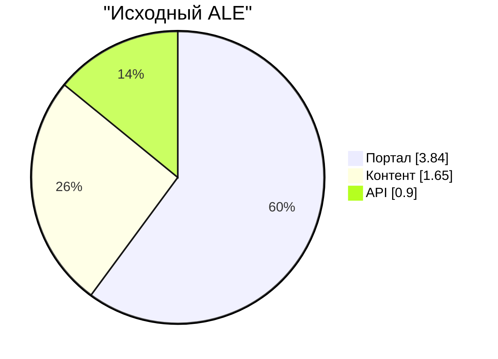
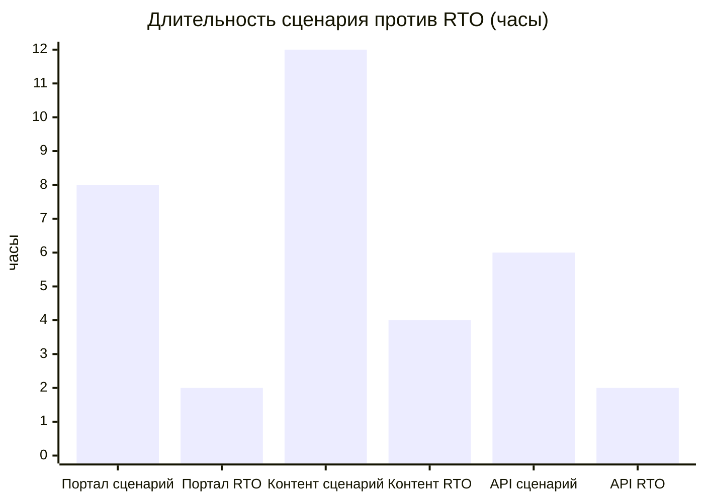

# 📊 FATHER — демонстрационный дашборд управления рисками

[← Главная](README.md) · [Нормативы](OFFICIAL_SOURCES.md) · [Исходный реестр](../cases/TRICOLOR/ФИНАНСОВЫЙ_РЕЕСТР_РИСКОВ.csv)

> Все данные ниже **синтетические** из трёх учебных сценариев. Это статический Markdown-дашборд, а не online-аналитика.

## Сводные KPI

| Метрика | Значение | Формула |
|---|---:|---|
| Исходный ALE | 6 390 000 ₽/год | 3 840 000 + 1 650 000 + 900 000 |
| Остаточный ALE | 2 694 000 ₽/год | 1 344 000 + 900 000 + 450 000 |
| Ожидаемое снижение потерь | 3 696 000 ₽/год | до − после |
| Годовые затраты на меры | 1 900 000 ₽/год | 1 200 000 + 500 000 + 200 000 |
| Условный чистый эффект | 1 796 000 ₽/год | снижение потерь − затраты |

## График: исходный и остаточный ALE по сценариям

## Структура предполагаемых первоначальных потерь

## Восстановление — целевые значения учебных процессов

| Процесс | RTO (цель) | RPO (цель) | Длительность одного учебного сценария |
|---|---:|---:|---:|
| Демо-портал | 2 ч | 15 мин | 8 ч |
| Доставка контента | 4 ч | 1 ч | 12 ч |
| Партнёрский API | 2 ч | 30 мин | 6 ч |

**RTO/RPO — согласуемые цели, а не факт достижения.** Сценарная длительность не измеренный показатель реальной организации.

## Воронка управления

## Критерии перехода к продуктивной аналитике
Отдельно хранить тип потерь (прямые / косвенные / потенциальные), источник данных, подтверждение, события-двойники, отклонения от целевого восстановления, версии моделей, неопределённость. Счётчики в README заменяются на реальные только после подключения источников, проверки качества и разрешения владельцев.
