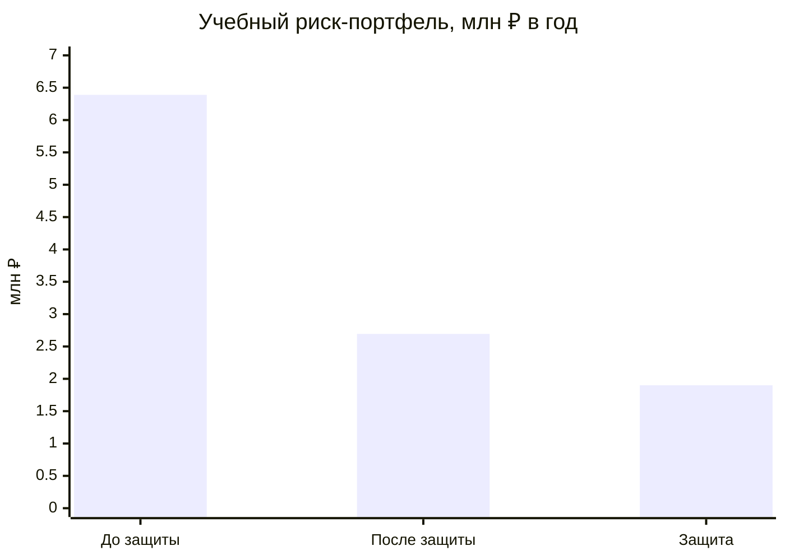
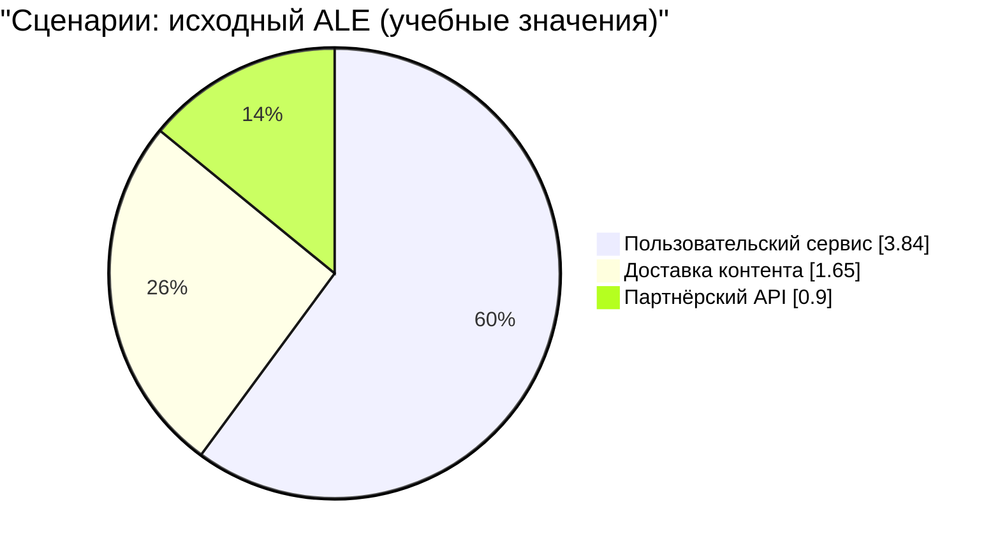
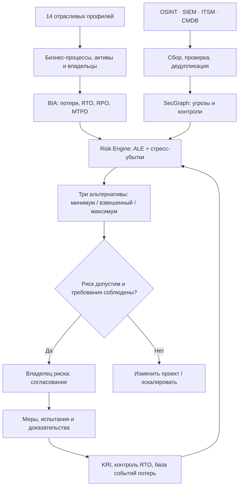
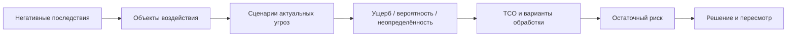

<div align="center">

# 🛡️ FATHER · RISK GOVERNANCE
### Отраслевой центр управления финансовыми и киберрисками

**Угроза → ущерб в ₽ → время восстановления → выбор защиты → решение владельца риска**


[📊 Дашборд](DASHBOARD.md) · [🗺️ Архитектура](ARCHITECTURE.md) · [📚 Отрасли](../industry-library/README.md) · [⚖️ Нормативная база](OFFICIAL_SOURCES.md) · [🛠️ План реализации](IMPLEMENTATION_PLAN.md)

</div>

> [!IMPORTANT]
> **Публичный учебный проект, а не действующая сертифицированная GRC-платформа.** Все графики ниже демонстрационные, основаны на синтетических предположениях, не отражают реальные инциденты и убытки каких-либо организаций. Жизнь, здоровье, безопасность полётов, экология, права граждан и обязательные требования — **жёсткие ограничения**, а не просто денежные коэффициенты.

## 🎯 Зачем это бизнесу

| Вопрос руководителя | Ответ системы |
|---|---|
| Что может произойти? | Актуальные сценарии угроз, активы, последствия |
| Сколько потеряем? | SLE, ALE, интервалы и стресс-убытки |
| Как долго продержимся? | MTPD, RTO, RPO, проверка восстановления |
| Во что обойдётся защита? | TCO, ожидаемый эффект, остаточный риск |
| Кто принимает решение? | Владелец риска, уровни полномочий, аудит |
| Сколько нужно наблюдателей? | Нагрузка на triage, автоматизация, контроль качества |

## 📊 Дашборд риск-портфеля — синтетический пример

| KPI | Учебная величина | Интерпретация |
|---|---:|---|
| Отраслевые профили | **14** | Шаблоны, не обследованные организации |
| Сценарии для демонстрации | **3** | Из ранее созданного учебного финансового реестра |
| Исходный ALE | **6,39 млн ₽/год** | Сумма демонстрационных сценариев |
| Остаточный ALE | **2,694 млн ₽/год** | Прогноз, не проверен |
| Издержки защиты | **1,9 млн ₽/год** | Условные операционные затраты |
| Чистый эффект | **1,796 млн ₽/год** | Без дисконтирования и хвостовых потерь |





[**➡ Полный дашборд, формулы и восстановление**](DASHBOARD.md) · [Учебный CSV с исходными расчётами](../cases/TRICOLOR/ФИНАНСОВЫЙ_РЕЕСТР_РИСКОВ.csv)

## 🏗️ Архитектура одного ядра



## 🧠 Процесс по ФСТЭК + финансовому управлению рисками



**Важно:** оценка актуальных угроз по Методике ФСТЭК и финансовая оценка риска — связанные, но различные этапы. **ALE = SLE × ARO** — наша упрощённая управленческая модель, не формула, предписанная ФСТЭК или Банком России.

## ⚖️ Официальные источники и нормативная трассировка

| Документ | Поставщик официального источника | Применение |
|---|---|---|
| **187-ФЗ от 26.07.2017** «О безопасности КИИ» | [Официальное опубликование](https://publication.pravo.gov.ru/document/view/0001201707260023) | Для субъектов и объектов КИИ при применимости |
| **716-П от 08.04.2020** | [Банк России: разъяснения по событиям и потерям](https://www.cbr.ru/faq_ufr/dbrnfaq/doc/forPrint/?id=1772) | Банковское управление операционным риском |
| **821-П от 17.08.2023** | [Банк России: официальный реестр «Вестника»](https://cbr.ru/about_br/publ/vestnik-search/?stext=821-%D0%9F) | Защита переводов в применимой сфере; учитывать изменения |
| **ISO/IEC 27005:2022** | [Официальный каталог ISO](https://www.iso.org/standard/80585.html) | Общие рекомендации по управлению рисками ИБ |
| **NIST CSF 2.0** | [Официальный NIST](https://www.nist.gov/cyberframework) | Govern → Identify → Protect → Detect → Respond → Recover |
| **Методика ФСТЭК 05.02.2021** | [Текст в правовой системе «КонсультантПлюс»](https://www.consultant.ru/document/cons_doc_LAW_378330/) | Определение негативных последствий и актуальных угроз |

> [!NOTE]
> Для Методики ФСТЭК дана **точная ссылка на документ у правового агрегатора**, не выдаваемая за официальный домен ФСТЭК. По 716-П дана официальная страница разъяснений ЦБ, **не полный текст** Положения. Для 821-П — официальный реестр публикаций, включая поправки. Разграничение источников и точные ссылки вынесены в [реестр нормативов](OFFICIAL_SOURCES.md). Актуальную редакцию проверять перед использованием.

## 🧩 14 отраслевых решений

| Отрасль | Характер ущерба и ограничения | Пример |
|---|---|---|
| 🏥 Медицина | Простой и безопасность пациентов | [Кейс](../industry-library/01_МЕДИЦИНА/КЕЙС.md) |
| ✈️ Авиация | Отмены рейсов и безопасность полётов | [Кейс](../industry-library/02_АВИАЦИЯ/КЕЙС.md) |
| 🛰️ Космос | Срыв задач миссии | [Кейс](../industry-library/03_КОСМОС/КЕЙС.md) |
| 🏛️ Государство | Бюджет и права граждан | [Кейс](../industry-library/04_ГОСУПРАВЛЕНИЕ/КЕЙС.md) |
| 🏦 Банки | Потери, платежи, операционный риск | [Кейс](../industry-library/05_БАНКИ/КЕЙС.md) |
| ⚡ Энергетика | Простои и технологическая безопасность | [Кейс](../industry-library/06_ЭНЕРГЕТИКА/КЕЙС.md) |
| 🚆 Транспорт | Перевозки и безопасность пассажиров | [Кейс](../industry-library/07_ТРАНСПОРТ/КЕЙС.md) |
| 📡 Телеком | Нарушения связи и SLA | [Кейс](../industry-library/08_ТЕЛЕКОМ/КЕЙС.md) |
| 🏭 Промышленность | Брак, простой, физические последствия | [Кейс](../industry-library/09_ПРОМЫШЛЕННОСТЬ/КЕЙС.md) |
| 🛍️ Ритейл | Упущенная маржа, возвраты | [Кейс](../industry-library/10_РИТЕЙЛ/КЕЙС.md) |
| 🎓 Образование | Данные учащихся и права | [Кейс](../industry-library/11_ОБРАЗОВАНИЕ/КЕЙС.md) |
| 🎬 Медиа | Контент, бренд и доступность | [Кейс](../industry-library/12_МЕДИА/КЕЙС.md) |
| 💧 Водоснабжение | Жизнеобеспечение | [Кейс](../industry-library/13_ВОДОСНАБЖЕНИЕ/КЕЙС.md) |
| 🚚 Логистика | Срыв поставок и порча товаров | [Кейс](../industry-library/14_ЛОГИСТИКА/КЕЙС.md) |

## 🛠️ Реализуемые подсистемы

```text
management-system/
├── README.md                 ← эта презентационная страница
├── DASHBOARD.md              ← синтетический дашборд и графики
├── OFFICIAL_SOURCES.md       ← ссылки и применимость нормативов
├── OPERATING_MODEL.md        ← роли, три линии контроля
├── ARCHITECTURE.md           ← граф и компоненты
├── TIERS.md                  ← минимум / взвешенный / максимум
├── AUTOMATION_POLICY.md      ← ограничения автоматизации
├── IMPLEMENTATION_PLAN.md    ← шаги внедрения
├── sector_profiles.json      ← 14 конфигураций отраслей
└── schema/risk_case.schema.json
```

**Проектный стек:** Python / FastAPI / PostgreSQL / SecGraph / граф рисков / SIEM-адаптеры / Mermaid / Markdown.

**Статус:** опубликованы архитектура, схемы, типовые кейсы и данные для демонстрации; исполняемый движок расчётов, интерактивный веб-дашборд, проверки нормативных ссылок в CI и реальные интеграции **ещё не реализованы**.

[Начать с дорожной карты →](IMPLEMENTATION_PLAN.md)
